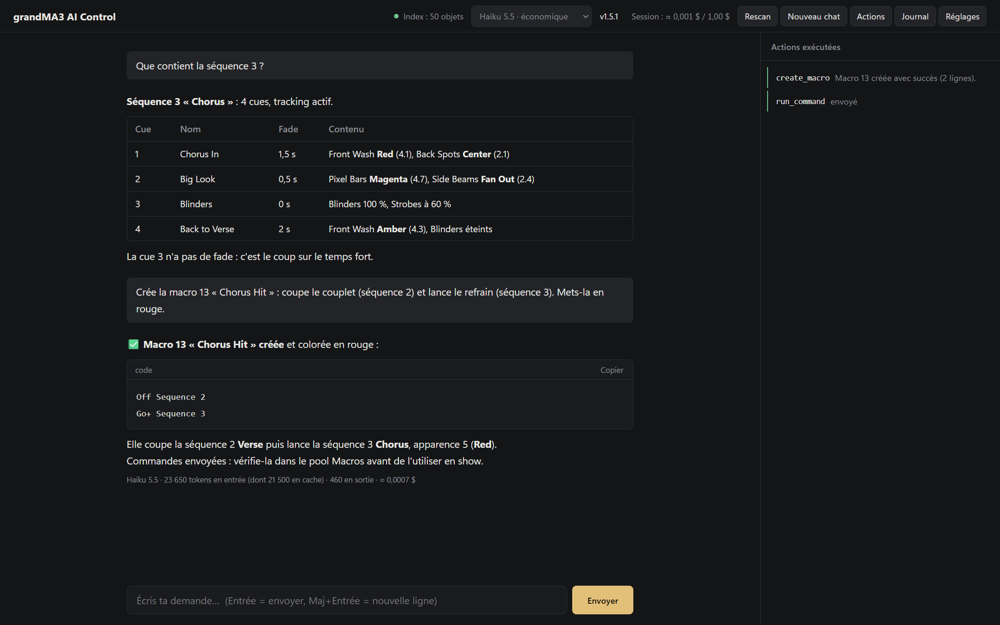
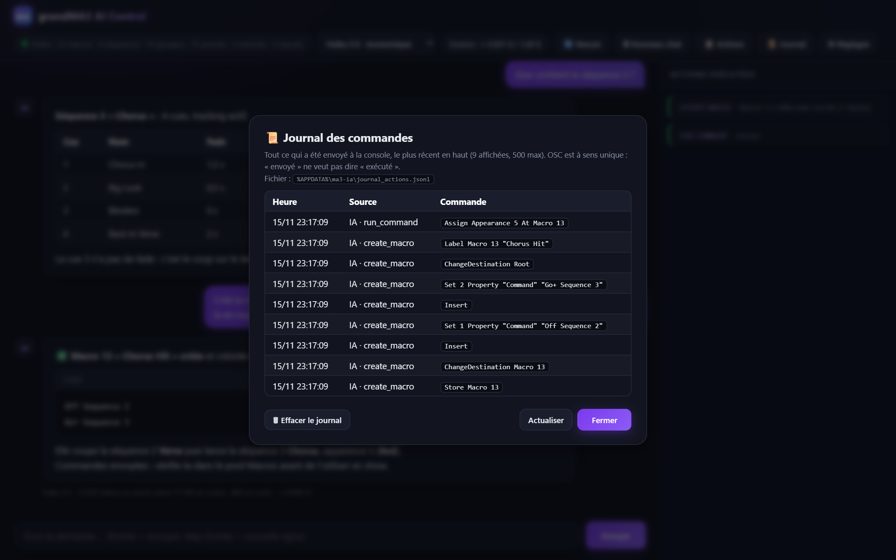

# MA3-IA — grandMA3 AI Control

🇬🇧 [English version](docs/README.en.md)

Assistant IA (Claude, API Anthropic) qui pilote une console **grandMA3 onPC** sous Windows :
il lit ton showfile (index + exports XML) et envoie des commandes à la console par **OSC**.

> ⚠️ **Projet indépendant, non affilié à MA Lighting Technology GmbH**, ni approuvé ou soutenu par elle.
> Voir [Mentions](#mentions).

> 🎭 **Un outil de préparation, pas un opérateur de spectacle.** MA3-IA t'aide à construire et à comprendre ton show
> (programmation, macros, recherche, explications). Il **ne remplace pas un humain pendant un live** : ne le laisse
> jamais piloter la console seul en plein spectacle. Les réponses de l'IA peuvent être fausses, et OSC ne confirme
> pas qu'une commande a réussi. En live, c'est toujours l'éclairagiste qui garde la main.

## Aperçu
*Captures réalisées avec un show de démonstration fictif.*

## Ce qu'il sait faire
- Répondre à des questions sur ton show (macros, séquences, presets, groupes, MAtricks, apparences).
- Créer et modifier des objets : macros (y compris en masse), MAtricks, grilles d'effets, commandes libres.
- Consulter le manuel officiel grandMA3 quand il doute d'une syntaxe.
- **Mode validation** (réglable) : l'IA prépare les commandes sans les envoyer, tu les vérifies dans le chat
  puis tu cliques sur « Envoyer » ou « Annuler ». Idéal en répétition.
- **Journal des commandes** : tout ce qui a été envoyé à la console, avec l'heure et l'outil de l'IA qui l'a envoyé.
- **Garde-fou de coût** : plafond de dépense par session, alerte à 80 %, blocage au plafond.
- **Sauvegarde automatique du show** avant chaque action de masse (génération de macros, Delete/Store/Copy/Move
  sur une plage) : l'app envoie `SaveShow`, et grandMA3 garde une copie datée dans *Backup Shows*.
- **Interface en français et en anglais** (automatique selon Windows, modifiable dans les Réglages).
- **Alerte de nouvelle version** : au lancement, l'app regarde la dernière Release GitHub (désactivable).

## Prérequis
- Windows 10/11 (64 bits), grandMA3 onPC. Python 3.12 seulement pour la version « code source ».
- Une clé API Anthropic (https://console.anthropic.com).
- Dans la console : OSC entrant activé (UDP, adresse `/cmd`). Le plugin `AI_Index` s'installe depuis l'app (voir plus bas).

## Installation
**Le plus simple : l'installateur** (aucun Python à installer)
1. Télécharge `MA3-IA-Setup-x.y.z.exe` dans les [Releases](https://github.com/elio7224/ma3-ia/releases).
2. Lance-le : il s'installe pour ton compte Windows, sans droits administrateur, avec raccourcis et désinstallation.
3. Au premier lancement, un assistant demande la clé API, l'adresse OSC de la console et vérifie le plugin.

> **« Windows a protégé votre ordinateur » ?** L'installateur n'est pas encore signé numériquement, et Windows
> SmartScreen avertit pour tout nouveau logiciel non signé. Clique sur **Informations complémentaires → Exécuter quand même**.
> Pour vérifier le fichier : il est construit par GitHub Actions directement depuis ce code (onglet *Actions*),
> et son empreinte SHA-256 est publiée avec la Release (`Get-FileHash .\MA3-IA-Setup-x.y.z.exe`).

**Depuis le code source** : télécharge le projet puis double-clique sur `scripts\run.bat` (crée l'environnement Python,
installe tout, crée un raccourci `MA3-IA` sur le Bureau).

Détails (données, création du `.exe`, tests) : voir [docs/README_BUREAU.md](docs/README_BUREAU.md).

## Sécurité
- La clé API est rangée dans le coffre Windows (Credential Manager), jamais dans un fichier du projet.
- OSC est à sens unique : l'IA envoie les commandes mais ne peut pas confirmer qu'elles ont réussi.
  Teste d'abord sur une copie de ton show.
- Avant une action de masse, le show est sauvegardé automatiquement (réglable dans ⚙ Réglages). Pour annuler :
  dans grandMA3, **Menu → Backup → Load → Backup Shows**, puis choisis la copie datée d'avant l'action.
- Pas d'IA aux commandes pendant un spectacle : utilise MA3-IA en préparation, en répétition ou hors public,
  et vérifie toujours le résultat sur la console avant de jouer.
- Ton historique de chat, tes réglages et le journal restent sur ton PC (dossier de configuration de l'app),
  jamais dans le dossier du projet.

## Le plugin AI_Index
Pour lire ton show, l'IA a besoin d'un petit plugin Lua dans grandMA3 : `plugin/ai_index.lua`.
- **Ce qu'il fait :** à chaque Rescan, l'app le lance par OSC ; il écrit la liste de tes objets (macros, séquences,
  groupes, presets…) dans `gma3_library\ai_index.json`, que l'IA lit ensuite. **Il ne modifie rien dans ton show.**
- **Installation automatique** (assistant de premier lancement ou ⚙ Réglages → « Installer automatiquement ») :
  1. l'app lance d'abord le plugin : s'il répond et qu'il est à jour, rien n'est importé (pas de doublon).
     Si c'est une ancienne version, elle la supprime (`Delete Plugin "AI_Index"`) pour la remplacer ; une pastille
     « 🔌 Plugin à mettre à jour » apparaît dans l'en-tête quand c'est le cas.
     S'il n'est pas encore là, la console affiche « Object not found » : c'est normal ;
  2. sinon elle écrit `ai_index.xml` dans `gma3_library\datapools\plugins` ;
  3. elle envoie `Import Plugin Library "ai_index.xml" At Plugin <n>` : le plugin arrive à l'emplacement choisi
     (99 par défaut, modifiable à côté du bouton ; **il doit être vide** dans le pool Plugins) ;
  4. elle le relance pour vérifier que l'index arrive.

  grandMA3 doit être ouvert avec l'OSC activé. Le plugin fait ensuite partie de ton show : **enregistre le show** pour le garder.
  Toutes les commandes envoyées sont visibles dans 📜 Journal.
- **Installation à la main** (si besoin) : dans le pool Plugins de grandMA3, importe `plugin/ai_index.lua` et nomme-le `AI_Index`.

## Licence
Code sous licence [MIT](LICENSE) : libre d'utilisation, de modification et de redistribution, en gardant la mention de copyright.

## Mentions
- Ce projet est **indépendant** : il n'est ni affilié à **MA Lighting Technology GmbH**, ni approuvé, sponsorisé ou soutenu par elle.
- « grandMA3 » et « MA Lighting » sont des marques de MA Lighting Technology GmbH, citées uniquement pour indiquer
  avec quel matériel l'application fonctionne.
- Le manuel grandMA3 n'est pas inclus : l'outil `doc_grandma3` télécharge à la demande les pages publiques
  de help.malighting.com, pour un usage local.
- L'application est fournie sans garantie (voir la licence). Teste toujours sur une copie de ton show avant un spectacle.

