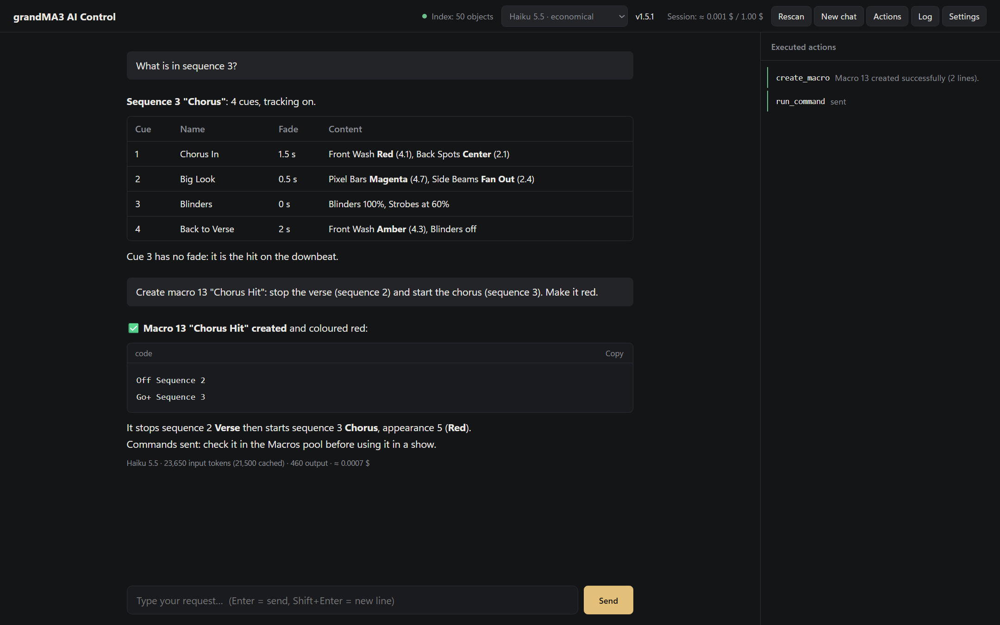
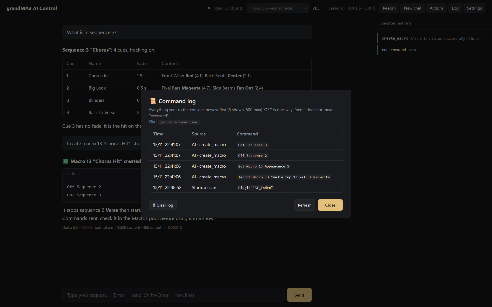

# MA3-IA — grandMA3 AI Control

🇫🇷 [Version française](../README.md)

An AI assistant (Claude, Anthropic API) that drives a **grandMA3 onPC** console on Windows or macOS:
it reads your showfile (index + XML exports) and sends commands to the console over **OSC**.

> ⚠️ **Independent project, not affiliated with MA Lighting Technology GmbH**, nor endorsed or supported by it.
> See [Notices](#notices).

> 🎭 **A preparation tool, not a show operator.** MA3-IA helps you build and understand your show
> (programming, macros, searching, explanations). It **does not replace a human during a live show**: never let it
> drive the console on its own mid-performance. The AI can be wrong, and OSC does not confirm that a command
> succeeded. During a live show, the lighting operator always stays in control.

## Screenshots
*Taken with a fictional demo show.*

## What it can do
- Answer questions about your show (macros, sequences, presets, groups, MAtricks, appearances).
- Create and edit objects: macros (including in bulk), MAtricks, effect grids, free commands.
  Macros are created through **XML import**: lines may contain quotes (`Lua "…"`) without breaking.
- Look up the official grandMA3 manual when it is unsure about a syntax.
- **Approval mode** (optional): the AI prepares the commands without sending them; you check them in the chat,
  then click "Send" or "Cancel". Ideal in rehearsal.
- **Command log**: everything sent to the console, with the time and the AI tool that sent it.
- **Cost guard**: spending limit per session, warning at 80%, requests blocked at the limit.
- **Automatic show backup** before every bulk action (macro generation, Delete/Store/Copy/Move on a range):
  the app sends `SaveShow`, and grandMA3 keeps a dated copy in *Backup Shows*.
- **English and French interface** (automatic from the system language, can be changed in Settings).
- **New version alert**: on launch, the app checks the latest GitHub Release (can be turned off).

The AI answers in the language you write in.

## Requirements
- Windows 10/11 (64-bit) or macOS (Apple Silicon Mac), grandMA3 onPC. Python 3.12 only for the "from source" version.
- An Anthropic API key (https://console.anthropic.com).
- On the console: incoming OSC enabled (UDP, address `/cmd`). The `AI_Index` plugin is installed from the app (see below).

## Installation
**Easiest: the installer** (no Python needed)
1. Download `MA3-IA-Setup-x.y.z.exe` from the [Releases](https://github.com/elio7224/ma3-ia/releases).
2. Run it: it installs for your Windows account, without admin rights, with shortcuts and an uninstaller.
3. On first launch, a wizard asks for the API key and the console's OSC address, and checks the plugin.

> **"Windows protected your PC"?** The installer is not code-signed yet, and Windows SmartScreen warns about any
> new unsigned program. Click **More info → Run anyway**.
> To verify the file: it is built by GitHub Actions straight from this source code (*Actions* tab),
> and its SHA-256 checksum is published with the Release (`Get-FileHash .\MA3-IA-Setup-x.y.z.exe`).

**On a Mac**: download `MA3-IA-x.y.z.dmg` from the [Releases](https://github.com/elio7224/ma3-ia/releases),
open it and drag **MA3-IA** into **Applications**.

> **"MA3-IA can't be opened" / "is damaged"?** The app is not notarized by Apple yet.
> On first launch: right-click MA3-IA → **Open** → **Open**. If macOS still refuses:
> **System Settings → Privacy & Security → Open Anyway**, or in Terminal
> `xattr -dr com.apple.quarantine /Applications/MA3-IA.app`.
> If the console runs on another machine on the network, accept the **local network** access prompt (needed for OSC).

**From source**:
- Windows: download the project, then double-click `scripts\run.bat` (creates the Python environment,
  installs everything, creates an `MA3-IA` shortcut on the Desktop).
- macOS: install Python 3.12 ([python.org](https://www.python.org/downloads/macos/)), then double-click
  `scripts/run.command` (creates the Python environment, installs everything and opens the app).

More details (data locations, building the `.exe`, tests): see [README_BUREAU.md](README_BUREAU.md) (in French).

## Security
- The API key is stored in the system keyring (Credential Manager on Windows, Keychain on macOS), never in a project file.
- OSC is one-way: the AI sends commands but cannot confirm they succeeded.
  Always test on a copy of your show first.
- Before a bulk action, the show is saved automatically (can be turned off in ⚙ Settings). To undo:
  in grandMA3, **Menu → Backup → Load → Backup Shows**, then pick the dated copy from before the action.
- No AI at the controls during a show: use MA3-IA for preparation, rehearsals or with no audience,
  and always check the result on the console before going live.
- Your chat history, settings and command log stay on your PC (the app's configuration folder),
  never in the project folder.

## The AI_Index plugin
To read your show, the AI needs a small Lua plugin in grandMA3: `plugin/ai_index.lua`.
- **What it does:** on every Rescan, the app runs it over OSC; it writes the list of your objects (macros, sequences,
  groups, presets…) to `gma3_library/ai_index.json`, which the AI then reads. **It does not change anything in your show.**
- **Automatic installation** (first-launch wizard or ⚙ Settings → "Install automatically"):
  1. the app first runs the plugin: if it answers and is up to date, nothing is imported (no duplicate).
     If it is an older version, the app deletes it (`Delete Plugin "AI_Index"`) to replace it; a
     "🔌 Plugin update available" badge shows in the header when that is the case.
     If it is not there yet, the console shows "Object not found": this is normal;
  2. otherwise it writes `ai_index.xml` to `gma3_library/datapools/plugins`;
  3. it sends `Import Plugin Library "ai_index.xml" At Plugin <n>`: the plugin lands in the chosen slot
     (99 by default, editable next to the button; **it must be empty** in the Plugins pool);
  4. it runs it again to check that the index arrives.

  grandMA3 must be open with OSC enabled. The plugin then becomes part of your show: **save the show** to keep it.
  Every command sent is visible in 📜 Log.
- **Manual installation** (if needed): in grandMA3's Plugins pool, import `plugin/ai_index.lua` and name it `AI_Index`.

## License
Code released under the [MIT](../LICENSE) license: free to use, modify and redistribute, as long as the copyright notice is kept.

## Notices
- This project is **independent**: it is not affiliated with, endorsed, sponsored or supported by **MA Lighting Technology GmbH**.
- "grandMA3" and "MA Lighting" are trademarks of MA Lighting Technology GmbH, mentioned only to indicate
  which hardware the application works with.
- The grandMA3 manual is not included: the `doc_grandma3` tool downloads the public pages of
  help.malighting.com on demand, for local use.
- The application is provided without warranty (see the license). Always test on a copy of your show before a performance.
